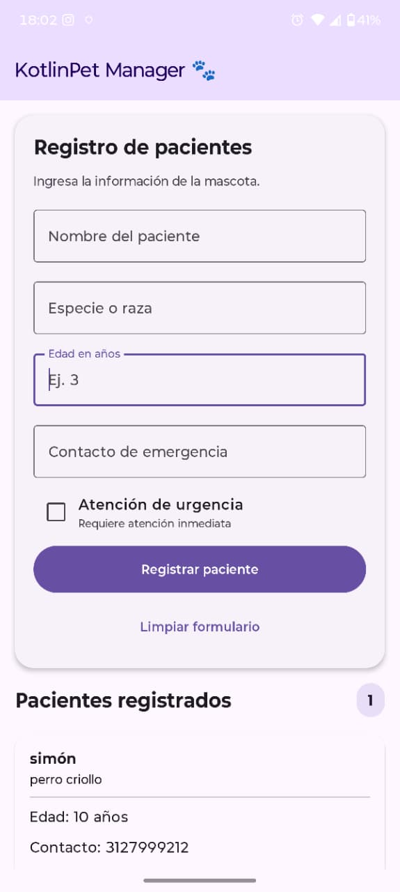
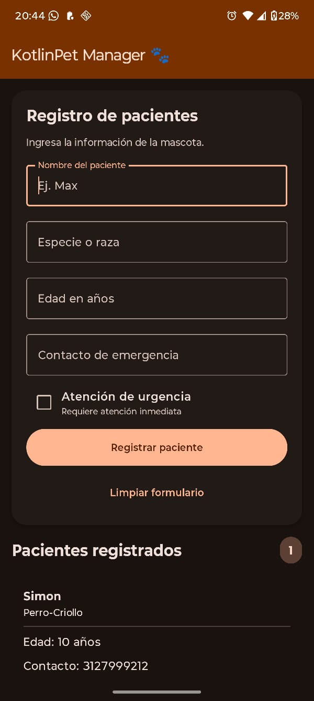

# KotlinPet Manager 🐾

Aplicación móvil desarrollada en Kotlin con Jetpack Compose y Material 3
para registrar y visualizar pacientes de una clínica veterinaria.

## Información académica

- **Estudiante:** Nicolás Cardona Ramírez
- **Código:** 1089380329
- **Asignatura:** Desarrollo de Aplicativos Móviles (EE053)
- **Proyecto:** KotlinPet Manager v1.0

## Funcionalidades

- Registro de pacientes veterinarios.
- Captura del nombre, especie o raza, edad y contacto de emergencia.
- Identificación de pacientes que requieren atención inmediata.
- Validación de los campos del formulario.
- Visualización dinámica de los pacientes mediante tarjetas.
- Limpieza del formulario y eliminación de registros.

## Tecnologías

- Kotlin
- Android Studio
- Jetpack Compose
- Material 3
- Arquitectura MVVM
- Git y GitHub

## Arquitectura

- `model/`: define la estructura de los datos del paciente.
- `viewmodel/`: administra el estado, las validaciones y los registros.
- `view/`: contiene la interfaz gráfica.
- `navigation/`: define las rutas de la aplicación.
- `MainActivity.kt`: inicia la aplicación.

## Captura de pantalla

## Captura de pantalla con colores dinámicos (ajuste a los colores del sistema)

## Ejecución

1. Clonar el repositorio.
2. Abrir el proyecto en Android Studio.
3. Esperar la sincronización de Gradle.
4. Ejecutar la aplicación en un emulador o dispositivo Android.
